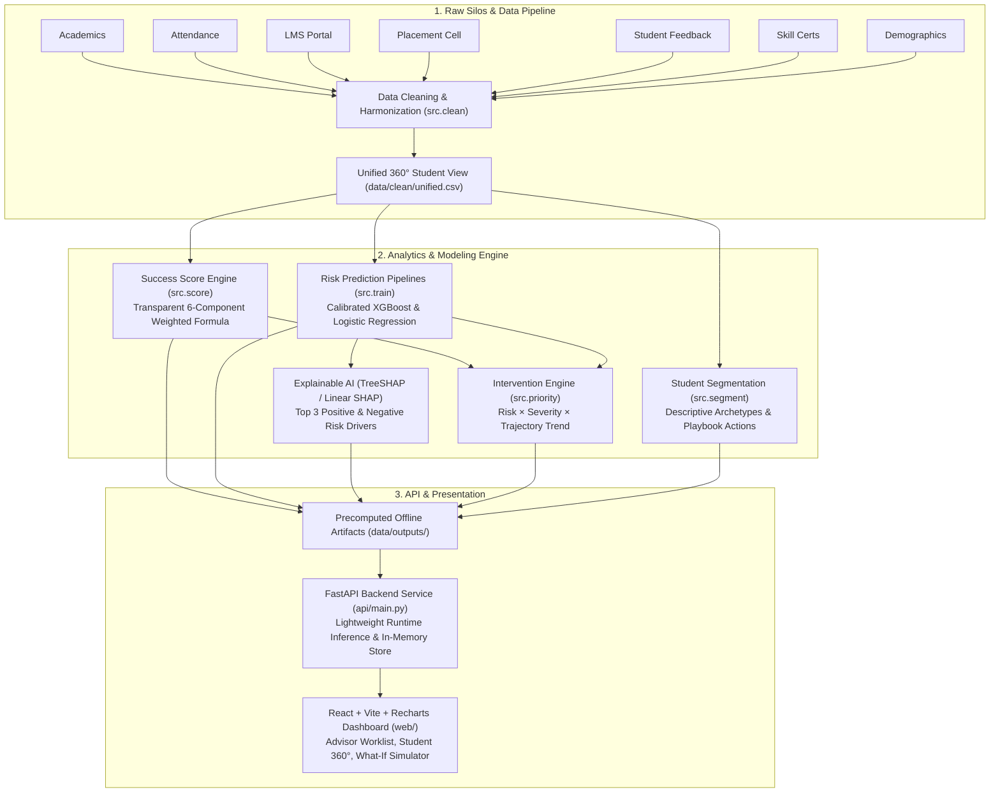

# 🎓 Smart Campus Student Success Platform

[](https://www.python.org/downloads/)
[](https://fastapi.tiangolo.com)
[](https://react.dev)
[](https://vitejs.dev)
[](https://scikit-learn.org)
[](https://xgboost.readthedocs.io)
[](https://shap.readthedocs.io)
[](https://github.com/astral-sh/ruff)
[](http://mypy-lang.org/)

An end-to-end, explainable predictive analytics and student success platform for higher education. The platform ingests and consolidates campus data silos across academics, attendance, learning management systems (LMS), placement readiness, and feedback to provide actionable early interventions for faculty advisors and placement officers.

---

## 📌 Executive Summary

Higher education institutions often struggle with fragmented student records across multiple departmental portals. This platform addresses that by:
1. **Unifying 7 Campus Tables** into a unified 360° longitudinal student profile.
2. **Computing Transparent Success Scores (0–100)** to measure present student standing without opaque black-box heuristics.
3. **Forecasting Next-Term Academic and Placement Risks** using calibrated machine learning (XGBoost and Logistic Regression).
4. **Providing Granular Model Interpretability** using TreeSHAP and linear SHAP feature attributions.
5. **Prioritizing Faculty Interventions** through an operational worklist driven by student risk, structural severity, and trailing trajectory trends.
6. **Delivering an Interactive React Dashboard** with cohort drilldowns, what-if sensitivity simulations, and intervention tracking.

---

## 🏗️ System Architecture



---

## ⚖️ The Three Core Concepts

To maintain institutional trust and ethical integrity, the system strictly isolates three distinct analytical metrics:

```
┌────────────────────────────────────────────────────────────────────────┐
│                        CORE ANALYTICAL METRICS                         │
├───────────────────────┬────────────────────────┬───────────────────────┤
│     SUCCESS SCORE     │   RISK PROBABILITIES   │    PRIORITY SCORE     │
│        (0–100)        │       (0.0–1.0)        │       (0–100+)        │
├───────────────────────┼────────────────────────┼───────────────────────┤
│ • Current state only  │ • Future forecast      │ • Operational urgency │
│ • Transparent weights │ • Calibrated ML models │ • Triage formula      │
│ • Fully explainable   │ • Academic & Placement │ • Drives worklist     │
└───────────────────────┴────────────────────────┴───────────────────────┘
```

### 1. Success Score (0–100)
A transparent, non-probabilistic index measuring a student's present academic and institutional health:
* **Academic Health (35%)**: $0.7 \times (\text{CGPA}/10) + 0.3 \times (1 - \min(\text{backlogs}, 5)/5)$
* **Attendance Rate (20%)**: Term attendance percentage normalized $0–100$.
* **LMS Engagement (15%)**: Mean of normalized login activity and assignment completion rate.
* **Placement Readiness (15%)**: Mean of aptitude, coding, and mock interview assessments.
* **Skills & Participation (10%)**: Extracurricular engagement, certifications, and hackathons.
* **Institutional Feedback (5%)**: Normalized student feedback and support ratings.
* *Missing Data Handling*: Components are dynamically reweighted over available data. If data availability falls below 50%, the score is marked as **"Insufficient Data"**.

### 2. Risk Probabilities (0.0 to 1.0)
* **Academic Risk**: Probability of a $\ge 0.5$ drop in next-semester CGPA or an active backlog.
* **Placement Risk**: Probability of non-placement or an offer below standard tier thresholds.
* **Model Selection & Calibration**: Evaluates class-balanced Logistic Regression vs. class-weighted XGBoost. Recalibrated via Platt/logistic scaling so predicted probabilities reflect true empirical cohort frequencies.

### 3. Intervention Priority Score
An operational ranking metric designed for academic advisors:
$$\text{Priority Score} = \min\left(100,\, 100 \times \text{Projected Risk} \times \text{Severity} \times \text{Trend Multiplier}\right)$$
* **Severity Multiplier**: $1.0$ if attendance $<75\%$ or $\ge 2$ backlogs; $0.8$ if attendance $75\%-80\%$ or $1$ backlog; otherwise $0.6$.
* **Trend Multiplier**: $1.2$ for worsening trajectories (`declining`), $1.0$ for `stable`, $0.8$ for improving trajectories.

---

## 🚀 Key Dashboard Capabilities

* **Campus Executive Summary**: Real-time KPI distributions (Green $\ge 70$, Amber $50–69$, Red $<50$), department breakdown, and risk exposure trends.
* **Advisor Priority Worklist**: Filterable, sorted intervention backlog displaying high-priority students, primary risk drivers, recommended action playbooks, and assignees.
* **Student 360° Detail View**: Longitudinal semester trajectory, individual radar components, and top 3 SHAP drivers per risk category.
* **Interactive What-If Simulator**: Allows advisors to simulate the impact of targeted improvements (e.g., $+15\%$ attendance or clearing a backlog) on predicted risk probabilities.
* **Intervention Tracker**: Log counseling sessions, remedial classes, or mock interview assignments, and compare against simulated follow-up milestones (Day 30 and Day 60).
* **Synthetic Data Upload & Batch Inference**: Upload new student CSV files or enter individual student profiles for real-time validation and lightweight inference.

---

## 🛠️ Tech Stack & Requirements

| Layer | Technologies |
|---|---|
| **Python Environment** | Python 3.13 (or 3.11+), NumPy, Pandas, Scikit-Learn, XGBoost, SHAP, Joblib |
| **Backend API** | FastAPI, Uvicorn, Pydantic v2, Starlette, SQLite (session store) |
| **Frontend UI** | React 18, Vite, Recharts, Lucide Icons, Modern CSS Modules |
| **Testing & Quality** | Pytest, Pytest-Cov, Ruff (linter & formatter), Mypy (type safety), ESLint |

---

## ⚡ Quickstart Guide

### 1. Prerequisites
* **Python 3.13** (recommended) or Python 3.11+
* **Node.js 18+** & npm

### 2. Setup Backend & Virtual Environment

From the project root:

```powershell
# Create and activate virtual environment (Windows PowerShell)
py -3.13 -m venv .venv
.\.venv\Scripts\Activate.ps1

# Upgrade pip and install dependencies
python -m pip install --upgrade pip
python -m pip install -r requirements.txt
```

> **Note on Windows PowerShell execution:** If PowerShell restricts script activation, run:
> ```powershell
> Set-ExecutionPolicy -Scope Process -ExecutionPolicy Bypass
> ```

### 3. Launch the FastAPI Backend

```powershell
# Set local session state path and launch Uvicorn
$env:RUNTIME_STATE_DB = Join-Path $env:TEMP "gravity-demo-session.sqlite3"
$env:GRAVITY_ML_BUNDLE = ""
python -m uvicorn api.main:app --host 127.0.0.1 --port 8000 --reload
```

* Backend will be available at: `http://127.0.0.1:8000`
* Interactive API Documentation (Swagger): `http://127.0.0.1:8000/docs`
* Health Check: `http://127.0.0.1:8000/health`

### 4. Launch the Frontend Dashboard

In a separate terminal window:

```powershell
cd web
npm ci
npm run dev -- --host 127.0.0.1 --port 5173
```

Open your browser to: **`http://localhost:5173`**

---

## 📊 Offline Pipeline & Data Generation

The runtime API reads precomputed artifacts from `data/outputs/` to maintain instant response times without heavy runtime retraining. To regenerate the synthetic data and model bundles:

```powershell
# 1. Generate synthetic campus data across 7 tables
python -m src.generate_data

# 2. Clean, validate, and build unified longitudinal datasets
python -m src.clean

# 3. Train models, compute SHAP values, and generate dashboard artifacts
python -m src.build_outputs --unified data/clean/unified.csv --outcomes data/clean/outcomes.csv
```

---

## 🧪 Testing & Code Quality

The codebase enforces strict quality standards with 100% reproducible tests (fixed random seed `42`):

```powershell
# Run backend test suite (56 core unit & integration tests)
python -m pytest -o addopts= -p no:cacheprovider -q -ra --ignore=tests/test_database.py --ignore=tests/test_migrations.py

# Linting and formatting checks
python -m ruff check .
python -m ruff format --check .

# Type checking
python -m mypy

# Frontend linting and tests
cd web
npm run lint
node --test src/analytics.test.js
npm run build
```

---

## 📡 API Reference Overview

| Endpoint | Method | Description |
|---|---|---|
| `GET /health` | `GET` | Health check probe |
| `GET /ready` | `GET` | Verifies demo artifacts and model availability |
| `GET /summary` | `GET` | Campus-wide overview metrics, KPI cards, and tier distributions |
| `GET /students` | `GET` | Paginated student list with filtering (department, tier, risk) |
| `GET /students/{id}` | `GET` | Detailed 360° student record, score components, and SHAP drivers |
| `GET /students/{id}/what_if` | `GET` | What-if feature perturbation analysis |
| `GET /worklist` | `GET` | Prioritized intervention list sorted by priority score |
| `GET /segments` | `GET` | Cohort segment breakdown and recommended playbooks |
| `GET /metrics` | `GET` | Model evaluation metrics (ROC-AUC, PR-AUC, Brier score, Confusion matrix) |
| `POST /data/upload` | `POST` | Upload custom student CSV for instant validation & scoring |
| `POST /interventions` | `POST` | Record a new student intervention event |

---

## 🛡️ Synthetic Data & Ethical Considerations

> **IMPORTANT DISCLAIMER**
> * **100% Synthetic Data**: All records, student identifiers, course grades, risk labels, and metric outputs are synthetically generated for demonstration and hackathon competition purposes.
> * **No Real-World Claims**: Predictions, SHAP attributions, and what-if sensitivity curves represent mathematical model associations within synthetic data; they do **not** claim real-world causal effects, psychological validity, or clinical accuracy.
> * **Human-in-the-Loop**: The platform is explicitly designed as a faculty decision-support system, not an automated decision maker. All interventions require advisor review and consent.

---

## 📄 License & Attribution

Developed for the KPMG Smart Campus Analytics Challenge.
Designed and maintained by **Garvit Kalra**.
